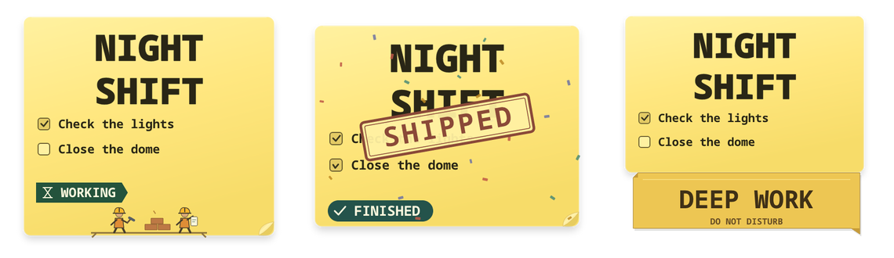

# OMP Sticky

**Keep your project and next steps in view.**

A yellow sticky note for an [Oh My Pi](https://github.com/can1357/oh-my-pi) terminal session, with a prominent project title and up to three task checkboxes. It starts at the top-right, then moves to the top-center as transcript output begins scrolling. On Hyprland, the desktop companion keeps it floating even while you browse native terminal scrollback.


The welcome state stays quiet until there is real work to display:


Local paper effects are on by default. The private LAN office board is opt-in.

## Install

Install into an existing OMP installation:

```sh
omp install omp-sticky
```

Start a new `omp` session. On **Linux x86-64 with Hyprland**, the package includes the desktop companion: no source checkout, compiler, npm account, API key, or separate daemon startup is needed. To update an existing npm install, run `omp plugin upgrade omp-sticky`, then restart OMP.

The desktop companion requires **Qt 6 and layer-shell-qt** at runtime. On Arch/Omarchy, install missing libraries with `sudo pacman -S --needed qt6-base qt6-declarative qt6-wayland layer-shell-qt`. The bundled binary targets current Arch/Omarchy; other distributions or CPU architectures may need a source build. Other compositors use the terminal-only backend with the limitations below.

If you previously installed the checkout as `omp-stickynote`, first run `omp plugin uninstall omp-stickynote`, then install `omp-sticky` and restart OMP. Saved note state remains compatible.

Remove it with `omp plugin uninstall omp-sticky`, then restart OMP.

### Build from source

For development or a system that cannot use the bundled companion:

```sh
git clone https://github.com/aChubbyNinja/omp-stickynote.git
cd omp-stickynote
./native/bin/build
omp install .
```

The companion build needs `qmake6`, a C++ compiler, `make`, Qt Quick/Wayland, and layer-shell-qt. On Arch/Omarchy, install missing prerequisites with `sudo pacman -S --needed base-devel qt6-base qt6-declarative qt6-wayland layer-shell-qt`.

Start a new `omp` session. The extension looks for a source-built companion first, then a bundled binary for the current platform/architecture, then `omp-stickynote-overlay` on `PATH`. Keep the checkout in place: local installation links to it. Update with `git pull`, rebuild with `./native/bin/build`, then restart OMP.

For an Arch package, run `./native/bin/package --install`. Its build directories are isolated from the project source. The package installs the companion; `omp install .` still installs the extension.

To use terminal-only rendering, skip the companion build or launch `OMP_STICKY_RENDERER=terminal omp`. A missing companion on Hyprland produces a setup notice; a failed companion reports the error before falling back.

Try it without installing:

```sh
omp -e /absolute/path/to/omp-stickynote/src/index.ts
```

## How it works

- **Automatic by default.** Uses the session title without OMP's decorative icon/tag prefix and follows the first three unfinished OMP todos in plan order. Once everything is complete, shows up to three completed tasks.
- **A clean welcome.** Before a session title or tasks exist, shows **READY TO BEGIN** and “Your project and next steps will appear here.” No working-directory name or automatic empty checkbox.
- **Readable at a glance.** Headlines are centered, extra-heavy, and displayed in all caps without changing the stored project title. Graphics use 50% larger headline type than v1.1.2. Task checkboxes and labels keep their original typography and case.
- **Only as wide as needed.** Startup stays compact. Once centered, graphic cards widen only if the title would otherwise be truncated after two rows. Expansion is symmetric, capped at 33% of the original paper width per side (66% total), and limited by the terminal viewport. Titles still use at most two rows and an ellipsis; font sizes and task wrapping do not change. A shorter title restores the compact width. [See adaptive sizing](assets/adaptive-width.png).
- **Pinned beyond scrollback.** Starts at the top-right and moves to the top-center as output scrolls. The desktop surface follows its owning terminal window, not the terminal's saved image rows. A new session resets the position.
- **A real soft shadow.** The desktop companion alpha-composites the paper and blurred shadow without a blank rectangular mat. Text remains visible through the shadow and around the rounded corners.
- **Double-click to minimize.** Double-click the expanded paper to tuck it into a small yellow `+` in the top-right corner of OMP. Single-click the `+` to reopen the note. Tasks keep updating in either state.
- **Keyboard focus stays in OMP.** A single click on the paper won't collapse it. On Hyprland the paper now receives pointer input, so clicks on it no longer select the text underneath. The transparent margin and shadow remain click-through. Minimize the note to interact with the transcript behind it.
- **Session-local.** The note and its minimized state follow the session branch on resume. Separate sessions do not share mutable note state. OMP controls persistence: a fresh session with no assistant turn may still be memory-only, and `--no-session` never saves it.
- **No extra model calls or telemetry.** Ordinary notes and local effects do not use the network. Explicitly enabling office sharing sends encrypted LAN multicast snapshots and release waves; see [LAN office](#lan-office).

## Commands

```text
/sticky Release dashboard | Finish UI | Verify checkout | Deploy
/sticky done 1
/sticky auto
/sticky hide
/sticky show
```

| Command | Effect |
| --- | --- |
| `/sticky Title \| task one \| task two \| task three` | Pin a manual title and one to three tasks. |
| `/sticky Title` | Pin a title with one empty checkbox. |
| `/sticky done N` | Toggle checkbox 1, 2, or 3 on a manual note. |
| `/sticky auto` | Return to the session title and live OMP todo list. |
| `/sticky minimize` | Same as double-clicking the paper: collapse to a clickable square without changing office sharing. |
| `/sticky hide` / `/sticky show` | Hide the note entirely or restore it at full size. |
| `/sticky` | Show command help. |
| `/sticky boring mode` / `/sticky fun on` | Turn local effects off or back on. The choice is saved with this session branch and does not change LAN sharing. |
| `/sticky dnd` | Toggle a larger **DEEP WORK** fold-out sign. |
| `/sticky dnd build` / `/sticky dnd off` | Show **WAITING ON A BUILD**, or restore the normal card. |
| `/sticky crumple` | Animate dismissal without deleting the title or tasks; `/sticky show` restores them. |
| `/sticky office on` / `/sticky office off` | Explicitly start or stop sharing this session on the configured LAN. |
| `/sticky office board` | Open the office board after sharing has been enabled. |

The `|` character separates fields; labels cannot contain it in slash commands. For those labels, ask the agent to use the `sticky_note` tool instead. The tool accepts a `title` and one to three `{ text, done }` tasks. Manual notes stay pinned until `/sticky auto`—automatic task updates do not overwrite them.

## Paper effects and office features

New sessions start in fun mode. Resuming a branch restores its last explicit preference, including an opt-out saved in an earlier version. DND, crumple, and office sharing remain separate actions.

1. **Victory moment.** Completing the remaining tasks under the same title shows **SHIPPED** and confetti for 3.6 seconds. Automatic notes follow the whole OMP checklist, even when more than three tasks finish together; only three rows are displayed. This celebrates checkboxes, not a software release.
2. **Curled paper and flutter.** A curled corner and brief flutter give real title/task changes and activity transitions a paper-like response.
3. **Handwritten checks.** Completed checkboxes use varied ink strokes, briefly drawing newly completed marks.
4. **Crumple and restore.** Dismiss the paper into a small crumpled ball, then restore the unchanged note with `/sticky show`. This works without fun mode.
5. **Attention badges.** **READY**, **WORKING**, **YOUR TURN**, and **FINISHED** follow main-session activity, questions/approval requests, and completion. The waiting pulse is brief, not an endless animation.
6. **Construction crew.** Watch for little hard hats when OMP writes or edits a file, or runs a recognized build or test. Workers linger after quick edits; only a build or test result earns **PASS** or **FAIL**.
7. **Milestone stamps.** **FIRST COMMIT**, **TESTS PASSED**, and **RELEASED** respond to supported command results, not words in a title or prompt.
8. **Do-not-disturb sign.** A larger fold-out **DEEP WORK** or **WAITING ON A BUILD** sign keeps the original note intact and suppresses fun effects until DND is off.
9. **LAN office board.** Explicitly share project titles, up to three tasks/check states, and attention status with a trusted group. `/sticky office board` opens a live, read-only dashboard.
10. **Release wave.** A recognized successful release sends a brief wave to office peers. Peers in fun mode display the wave; receiving one never retransmits it.



### Fast local demo

Enter these commands in an interactive OMP session, pausing after each checkbox to see the effect:

```text
/sticky Release rehearsal | Prepare | Review | Finish
/sticky done 1
/sticky done 2
/sticky done 3
/sticky dnd
/sticky dnd build
/sticky dnd off
/sticky crumple
/sticky show
```

The third tick triggers the victory moment; it does not publish anything. `/sticky dnd` toggles deep work; `/sticky dnd build` selects the build sign explicitly. **Ctrl+Alt+D** also toggles deep work. To leave that shortcut unbound, start OMP with `OMP_STICKY_DND_SHORTCUT=off omp` and use the slash commands instead. DND is a visual sign, not an operating-system notification blocker, and does **not** stop office sharing.

Use `/sticky boring mode` to disable local effects, or `/sticky auto` to follow OMP todos again. Saved notes are not rewritten by animations; restoring or navigating branches does not replay old celebrations. Graphics backends show the artwork; ANSI fallback gives readable status labels rather than equivalent animation.

### What activity signals mean

Project effects follow actual title/task changes. The crew watches main-session file writes and edits as well as recognized foreground build/test commands. Writing files doesn't imply that tests passed. Shell milestones require a matched tool result. The note does not watch other terminals, arbitrary scripts, CI, subagents, or background jobs.

Recognized commands include `npm test`, `npm run build` and equivalent pnpm/yarn/bun commands; Cargo and Go test/build commands; `node --test`, pytest, Jest, and `vitest run`. A literal chain such as `cd app && npm run check && npm test` can earn **TESTS PASSED** when the entire command succeeds. Pipes, arbitrary wrappers and shell expansions are not treated as proof. Help, dry-run, watch, listing, and other non-execution modes are excluded.

**FIRST COMMIT** means the first observed successful `git commit` in the current activity lifecycle, not the repository's first-ever commit. **RELEASED** requires a successful supported npm/pnpm/yarn/Cargo publish or `gh release create` result with matching final publication evidence in its output. Draft, staged, dry-run, failed, cancelled, and still-running results do not count. Unrecognized output may produce no stamp. A title such as “release complete” or an assistant's claim cannot trigger a release stamp or office wave.

## LAN office

Office is **off by default**, independent of fun mode, and never starts just because environment variables exist. There is no cloud service, Internet rendezvous, or automatic pairing. All participants must be on the same multicast-capable IPv4 LAN and explicitly enable sharing.

### Pair two machines privately

Use **one shared random key** for the intended group, not a different key on each machine. On both machines, prepare a private directory:

```sh
install -d -m 700 "$HOME/.config/omp-sticky"
```

On **one machine only**, generate 32 random bytes encoded as 64 hexadecimal characters directly into a private file:

```sh
(umask 077; openssl rand -hex 32 > "$HOME/.config/omp-sticky/office.key")
chmod 600 "$HOME/.config/omp-sticky/office.key"
```

Transfer that file privately to the second machine, for example over authenticated SSH after checking its host key (replace `user@peer`):

```sh
scp "$HOME/.config/omp-sticky/office.key" user@peer:.config/omp-sticky/office.key
```

Do not print or paste the key into shell commands/history, chat, screenshots, issue reports, or commits. Keep both copies owned by their user with mode **0600**; do not put the file in the project checkout. The transfer command contains a file path, not the secret.

In **each machine's Bash shell**, load the key without echoing it and select that machine's actual LAN IPv4 address:

```sh
set +x
chmod 600 "$HOME/.config/omp-sticky/office.key"
export OMP_STICKY_OFFICE_KEY="$(cat "$HOME/.config/omp-sticky/office.key")"
ip -4 address show
read -r -p "This machine's LAN IPv4 address: " OMP_STICKY_OFFICE_INTERFACE
export OMP_STICKY_OFFICE_INTERFACE
# Optional display name; otherwise the hostname is used.
export OMP_STICKY_OFFICE_NAME="Workstation"
omp
```

Choose the address assigned to the intended Ethernet/Wi-Fi interface, not the other machine's address or a router address. Use a distinct optional name on each machine. Keep shell tracing off while loading secrets; the key is inherited by OMP and its child processes, so use only a trusted session.

In OMP on **both machines**:

```text
/sticky office on
/sticky office board
```

The live, read-only board lists **SELF** and **REMOTE** sessions with names, project titles, tasks, and attention states. It updates automatically; use the arrow keys to scroll and **Escape** or **q** to close it without stopping sharing. Snapshots are coalesced to at most one per second with a five-second heartbeat. A recognized release on one peer sends a wave; manually ticking tasks to victory does not. Fun is needed for visible waves, not for the board or network sharing.

### Network and trust boundaries

- Transport is authenticated encryption (**AES-256-GCM**) to multicast group **239.255.77.80**, **UDP 47831**, **TTL 1**, through the explicitly selected interface. Allow that multicast traffic only on the intended LAN. Wi-Fi client isolation, VPNs, firewalls, or multicast filtering may prevent discovery; this is not cross-network/Internet sync.
- Shared fields are a sanitized device name, ephemeral session identity, title, up to three task labels/check states, attention status, and protocol timing/sequence data. Prompts, transcripts, working directories, environment variables, and the key are not snapshot fields. **Titles and tasks can still be sensitive.**
- The key authenticates a **trusted group**, not individual users or machines: any key holder can read group snapshots or impersonate another participant. Share only with trusted peers; revoke membership by stopping sharing and rotating the key on all remaining machines, then restarting OMP with the new key. TTL 1 is a routing constraint, not a security boundary.
- `/sticky office off`, hiding, crumpling, leaving/switching the session, and branch navigation stop sharing. `/sticky show` does not re-enable it. A clean exit sends a best-effort leave message; after an unclean exit or lost message, peers may remain visible until their **20-second** expiry.
- `/sticky boring mode`, closing the board, or enabling DND does **not** stop sharing. Use `/sticky office off` to end the network session.

## Display and compatibility

- Warm yellow paper and dark ink, independent of your OMP theme.
- The **desktop backend** uses a transparent Qt Quick layer-shell surface. It follows the terminal identified by OMP's process ancestry, hides when that window is off-workspace or covered, and exits with the session. It does not guess the active window.
- The **terminal backend** uses host-native SVG rasterization and SIXEL/Kitty/iTerm graphics when available, or a readable ANSI fallback. It cannot keep a graphic pinned while the terminal itself browses native scrollback; SIXEL also cannot alpha-blend a shadow over underlying text. Use the desktop companion for those features.
- ANSI text cannot enlarge individual fonts; terminal zoom controls its size.
- The paper starts approximately 50 terminal columns wide, plus transparent shadow gutters. Long titles can widen the centered graphic card by up to 66%; task labels never trigger expansion. Graphics fit the actual available viewport, without an arbitrary 18-row height cap.
- This is an overlay, not reserved layout space: the opaque paper covers output beneath it. `/sticky hide` reveals that output. The desktop card is not copied into terminal selections or scrollback; the original transcript remains intact.
- Interactive TUI only. Print, JSON, RPC, and subagent sessions do not mount the note.
- The Hyprland companion and terminal backend support double-click to minimize and single-click to restore. The terminal backend targets the OMP **18.21.0** API and uses terminal mouse reporting while the note is visible. If your terminal cannot forward clicks, or you use Tern’s native UI, use `/sticky minimize` and `/sticky show`.
- Office transport was tested with two loopback sessions, not two physical computers.
- Terminal-server instances sharing one PID, remote SSH sessions, and multiplexers may not have an unambiguous compositor-window ancestor; the companion reports this rather than attaching to the wrong session. Other compositors currently use terminal rendering.

The [native scrollback screenshot](assets/scrollback.png) shows the same card staying fixed over older output.

The terminal-only compatibility path uses OMP 18.21.0's exposed overlay stack to retain editor focus and a post-paint callback to bypass its SIXEL-unsafe partial-overlay text slicer. The desktop path does not reserve or erase terminal cells and never writes the note image into the terminal.

## Development

Development requires **Node.js 24+** and an installed `omp` executable in `PATH`. Type checking targets OMP **18.21.0**; runtime dependencies are supplied by OMP.

```sh
npm ci --ignore-scripts
npm run check
npm test
./native/bin/build
./native/bin/test
omp --no-extensions -e ./src/index.ts
```

`src/state.ts` handles safe labels and branch-local restoration. `src/effects.ts` schedules finite local effects; `src/activity.ts` correlates host activity and supported command results. `src/art.ts` and `src/paper.ts` define artwork, shared typography, and alpha-preserving SVG. `src/office.ts` and `src/office-wire.ts` implement opt-in LAN transport and its authenticated packet format. `src/desktop.ts` manages cached PNG rendering and the companion's process/protocol lifecycle. `native/` owns the Qt surface, ancestor-PID matching, Hyprland IPC, visibility, and placement. `src/note.ts` supplies terminal rendering; `src/index.ts` owns backend selection and session commands.

`npm test` covers state restoration, effects, activity-result correlation, office packets/transport, and real OMP text/SIXEL rendering; the rendering tests find the installed host rather than npm's dependency-local Bun CLI. Set `OMP_BIN=/absolute/path/to/omp` to select it explicitly. Native tests cover ownership ambiguity, placement, scaling, workspaces, and occlusion. Hosted CI is not configured.

`npm pack` builds, checks the version, and strips the Linux x86-64 companion into the release tarball. Run it on a current Arch/Omarchy x86-64 build machine with the native build prerequisites installed. The published package does not run dependency installation scripts or download executables at startup.

For integration changes, use a real terminal: type with the note visible, generate output, scroll back and forward with the terminal's own controls, hide/show, resize or move the window, and start a new session. Verify both the desktop path and `OMP_STICKY_RENDERER=terminal` fallback. Never publish screenshots containing private session content.

Contributions and reproducible bug reports are welcome. Include your OMP version, terminal, operating system, and reproduction steps. Do not attach API keys or private transcripts. For a sensitive report, use [GitHub private vulnerability reporting](https://github.com/aChubbyNinja/omp-stickynote/security/advisories/new).

## License

[MIT](LICENSE). Independent community project; not affiliated with or endorsed by Oh My Pi.
