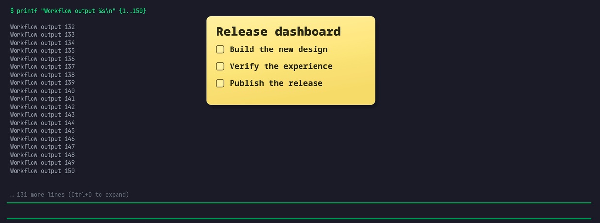
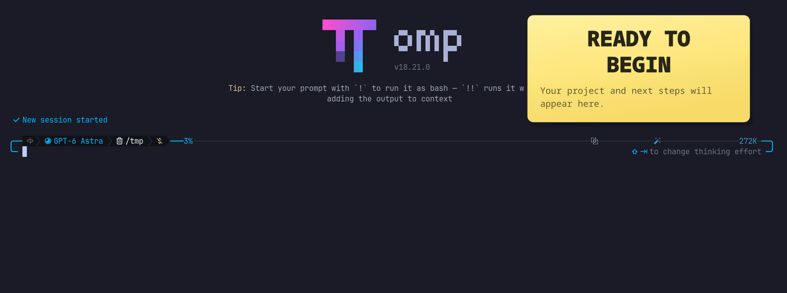

# OMP Sticky

**Keep your project and next steps in view.**

A yellow sticky note for an [Oh My Pi](https://github.com/can1357/oh-my-pi) terminal session, with a prominent project title and up to three task checkboxes. It starts at the top-right, then moves to the top-center as transcript output begins scrolling. On Hyprland, the desktop companion keeps it floating even while you browse native terminal scrollback.



The welcome state stays quiet until there is real work to display:



## Install

Install into an existing OMP installation (tested with **18.21.0 and 18.22.0**):

```sh
omp install omp-sticky
```

Start a new `omp` session. On **Linux x86-64 with Hyprland**, the package includes the desktop companion: no source checkout, compiler, npm account, API key, or separate daemon startup is needed. Repeat the install command to update, then restart OMP.

The desktop companion requires **Qt 6 and layer-shell-qt** at runtime. On Arch/Omarchy, install missing libraries with `sudo pacman -S --needed qt6-base qt6-declarative qt6-wayland layer-shell-qt`. The bundled binary targets current Arch/Omarchy; other distributions or CPU architectures may need a source build. Other compositors use the terminal-only backend with the limitations below.

If you previously installed the checkout as `omp-stickynote`, first run `omp plugin uninstall omp-stickynote`, then install `omp-sticky` and restart OMP. Saved note state remains compatible.

Remove it with `omp plugin uninstall omp-sticky`, then restart OMP.

### Build from source

For development or a system that cannot use the bundled companion:

```sh
git clone https://github.com/aChubbyNinja/omp-stickynote.git
cd omp-stickynote
./native/bin/build
omp install .
```

The companion build needs `qmake6`, a C++ compiler, `make`, Qt Quick/Wayland, and layer-shell-qt. On Arch/Omarchy, install missing prerequisites with `sudo pacman -S --needed base-devel qt6-base qt6-declarative qt6-wayland layer-shell-qt`.

Start a new `omp` session. The extension looks for a source-built companion first, then a bundled binary for the current platform/architecture, then `omp-stickynote-overlay` on `PATH`. Keep the checkout in place: local installation links to it. Update with `git pull`, rebuild with `./native/bin/build`, then restart OMP.

For an Arch package, run `./native/bin/package --install`. Its build directories are isolated from the project source. The package installs the companion; `omp install .` still installs the extension.

To use terminal-only rendering, skip the companion build or launch `OMP_STICKY_RENDERER=terminal omp`. A missing companion on Hyprland produces a setup notice; a failed companion reports the error before falling back.

Try it without installing:

```sh
omp -e /absolute/path/to/omp-stickynote/src/index.ts
```

## How it works

- **Automatic by default.** Uses the session title without OMP's decorative icon/tag prefix and follows the first three unfinished OMP todos in plan order. Once everything is complete, shows up to three completed tasks.
- **A clean welcome.** Before a session title or tasks exist, shows **READY TO BEGIN** and “Your project and next steps will appear here.” No working-directory name or automatic empty checkbox.
- **Readable at a glance.** Headlines are centered, extra-heavy, and displayed in all caps without changing the stored project title. Graphics use 50% larger headline type than v1.1.2. Task checkboxes and labels keep their original typography and case.
- **Only as wide as needed.** Startup stays compact. Once centered, graphic cards widen only if the title would otherwise be truncated after two rows. Expansion is symmetric, capped at 33% of the original paper width per side (66% total), and limited by the terminal viewport. Titles still use at most two rows and an ellipsis; font sizes and task wrapping do not change. A shorter title restores the compact width. [See adaptive sizing](assets/adaptive-width.png).
- **Pinned beyond scrollback.** Starts at the top-right and moves to the top-center as output scrolls. The desktop surface follows its owning terminal window, not the terminal's saved image rows. A new session resets the position.
- **A real soft shadow.** The desktop companion alpha-composites the paper and blurred shadow without a blank rectangular mat. Text remains visible through the shadow and around the rounded corners.
- **Input stays yours.** The desktop surface accepts neither pointer nor keyboard input: clicking, selecting text, and scrolling still reach the terminal underneath.
- **Session-local.** Manual notes and visibility are stored in OMP's session entries and restored on resume or branch navigation. Separate sessions do not share mutable note state. OMP controls persistence: a fresh session with no assistant turn may still be memory-only, and `--no-session` never saves it.
- **No extra model calls.** The extension uses OMP's existing title and task state. It makes no network requests and adds no telemetry.

## Commands

```text
/sticky Release dashboard | Finish UI | Verify checkout | Deploy
/sticky done 1
/sticky auto
/sticky hide
/sticky show
```

| Command | Effect |
| --- | --- |
| `/sticky Title \| task one \| task two \| task three` | Pin a manual title and one to three tasks. |
| `/sticky Title` | Pin a title with one empty checkbox. |
| `/sticky done N` | Toggle checkbox 1, 2, or 3 on a manual note. |
| `/sticky auto` | Return to the session title and live OMP todo list. |
| `/sticky hide` / `/sticky show` | Hide or restore the note for this session. |
| `/sticky` | Show command help. |

The `|` character separates fields; labels cannot contain it in slash commands. For those labels, ask the agent to use the `sticky_note` tool instead. The tool accepts a `title` and one to three `{ text, done }` tasks. Manual notes stay pinned until `/sticky auto`—automatic task updates do not overwrite them.

## Display and compatibility

- Warm yellow paper and dark ink, independent of your OMP theme.
- The **desktop backend** uses a transparent Qt Quick layer-shell surface. It follows the terminal identified by OMP's process ancestry, hides when that window is off-workspace or covered, and exits with the session. It does not guess the active window.
- The **terminal backend** uses host-native SVG rasterization and SIXEL/Kitty/iTerm graphics when available, or a readable ANSI fallback. It cannot keep a graphic pinned while the terminal itself browses native scrollback; SIXEL also cannot alpha-blend a shadow over underlying text. Use the desktop companion for those features.
- ANSI text cannot enlarge individual fonts; terminal zoom controls its size.
- The paper starts approximately 50 terminal columns wide, plus transparent shadow gutters. Long titles can widen the centered graphic card by up to 66%; task labels never trigger expansion. Graphics fit the actual available viewport, without an arbitrary 18-row height cap.
- This is an overlay, not reserved layout space: the opaque paper covers output beneath it. `/sticky hide` reveals that output. The desktop card is not copied into terminal selections or scrollback; the original transcript remains intact.
- Interactive TUI only. Print, JSON, RPC, and subagent sessions do not mount the note.
- Desktop backend verified with Foot on OMP 18.22.0, Hyprland, Qt 6.12, and layer-shell-qt 6.8.1. The terminal backend targets OMP **18.21.0**. Other OMP releases and native Tern rendering are not verified.
- Terminal-server instances sharing one PID, remote SSH sessions, and multiplexers may not have an unambiguous compositor-window ancestor; the companion reports this rather than attaching to the wrong session. Other compositors currently use terminal rendering.

The [native scrollback screenshot](assets/scrollback.png) shows the same card staying fixed over older output.

The terminal-only compatibility path uses OMP 18.21.0's exposed overlay stack to retain editor focus and a post-paint callback to bypass its SIXEL-unsafe partial-overlay text slicer. The desktop path does not reserve or erase terminal cells and never writes the note image into the terminal.

## Development

Development requires **Node.js 24+** and an installed `omp` executable in `PATH`. Type checking targets OMP **18.21.0**; runtime dependencies are supplied by OMP.

```sh
npm ci --ignore-scripts
npm run check
npm test
./native/bin/build
./native/bin/test
omp --no-extensions -e ./src/index.ts
```

`src/state.ts` handles safe labels and branch-local restoration. `src/paper.ts` defines the shared typography and alpha-preserving SVG. `src/desktop.ts` manages cached PNG rendering and the companion's process/protocol lifecycle. `native/` owns the Qt surface, ancestor-PID matching, Hyprland IPC, visibility, and placement. `src/note.ts` supplies terminal rendering; `src/index.ts` owns backend selection and session commands.

`npm test` exercises state restoration and real OMP text/SIXEL rendering; it finds the installed host rather than npm's dependency-local Bun CLI. Set `OMP_BIN=/absolute/path/to/omp` to select it explicitly. Native tests cover ownership ambiguity, placement, scaling, workspaces, and occlusion. Hosted CI is not configured.

`npm pack` builds, checks the version, and strips the Linux x86-64 companion into the release tarball. Run it on a current Arch/Omarchy x86-64 build machine with the native build prerequisites installed. The published package does not run dependency installation scripts or download executables at startup.

For integration changes, use a real terminal: type with the note visible, generate output, scroll back and forward with the terminal's own controls, hide/show, resize or move the window, and start a new session. Verify both the desktop path and `OMP_STICKY_RENDERER=terminal` fallback. Never publish screenshots containing private session content.

Contributions and reproducible bug reports are welcome. Include your OMP version, terminal, operating system, and reproduction steps. Do not attach API keys or private transcripts. For a sensitive report, use [GitHub private vulnerability reporting](https://github.com/aChubbyNinja/omp-stickynote/security/advisories/new).

## License

[MIT](LICENSE). Independent community project; not affiliated with or endorsed by Oh My Pi.
